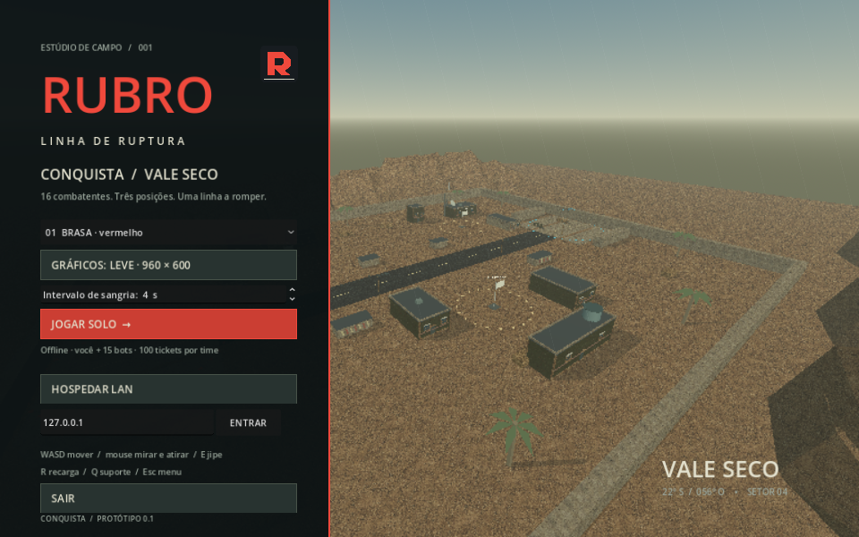
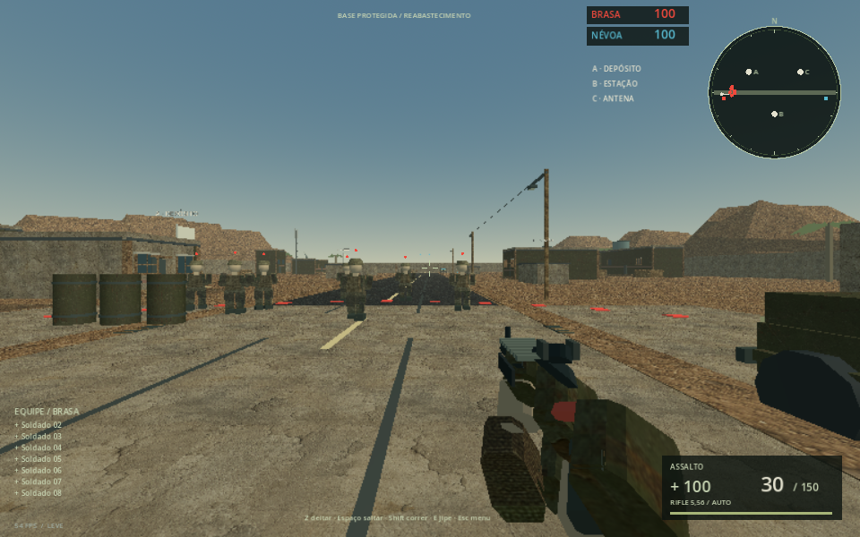
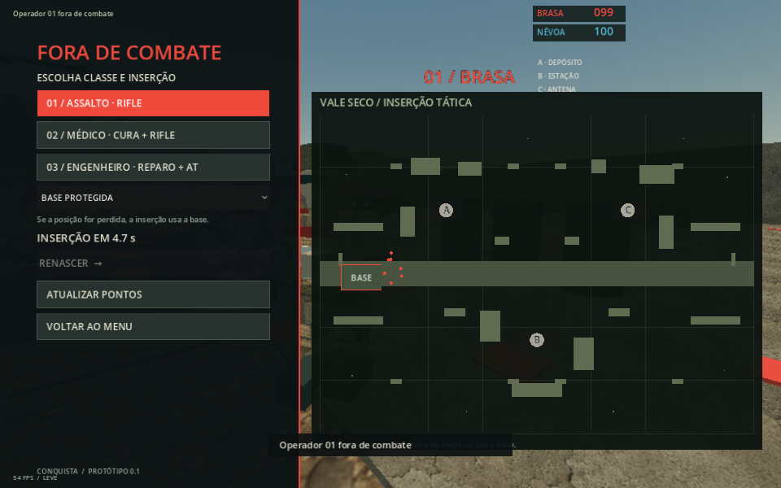

# RUBRO: Linha de Ruptura

FPS 3D de Conquista, em **Godot 4.5.1 + GDScript**, com renderizador **Compatibility**. Identidade própria: vermelho de sinal, carvão e papel, militares low-poly e mapa original **Vale Seco**. Inspiração nas regras de Conquista dos FPS de 2005; nenhum conteúdo de Battlefield foi reutilizado.



## Jogar agora

Versão **0.2.0**, com texturas e modelos próprios atualizados em 17/11/2026. Os builds gerados localmente ficam na pasta `builds/` e não são incluídos no Git. Para gerá-los, consulte **Exportar novamente** abaixo:

| Plataforma | Arquivo | Exportado | Executado/testado |
|---|---|---|---|
| Linux x64 | `builds/linux/RUBRO.x86_64` | Sim | Linux: interface OpenGL, solo, regras e LAN local |
| Windows x64 | `builds/windows/RUBRO.exe` | Sim | Não; sem Windows/Wine disponível |
| macOS universal | `builds/macos/RUBRO.zip` | Sim | Não; sem Mac disponível |

Linux: abra `RUBRO.x86_64`; se necessário, `chmod +x builds/linux/RUBRO.x86_64`. O executável inclui os recursos: não precisa instalar Godot nem conectar à internet. Windows: abra o `.exe`. macOS: extraia o ZIP e abra o aplicativo `.app` dentro dele; é um build sem assinatura/notarização, sujeito à confirmação de abertura do macOS.

Na entrega local, `builds/RUBRO-fonte.zip` contém o projeto, mapa, assets, testes e documentação, e `builds/SHA256SUMS.txt` registra os hashes. Esses arquivos de distribuição não fazem parte do Git. No GitHub, use **Code → Download ZIP** ou clone este repositório para obter o projeto-fonte.

Para editar: importe `project.godot` na **Godot 4.5.1** e pressione F6 na cena principal ou F5 no projeto. Não há plugins, pacotes, serviços ou downloads em tempo de execução.

## Desempenho neste PC

O padrão **LEVE** foi ajustado para o hardware disponível: **Celeron N4020 (2 núcleos) / Intel UHD 600**. O botão **GRÁFICOS** no menu e no Esc alterna os presets e salva a escolha localmente:

| Preset | Janela | Renderização 3D | Sombras |
|---|---|---|---|
| Leve (padrão) | 960 × 600 | 80%, HUD nítido | Projeções estáticas leves |
| Equilibrado | 1280 × 800 | 100% | Dinâmicas a 70 m |
| Alto | 1440 × 900 | 100%, MSAA 2× | Dinâmicas a 110 m |

O executável Linux 0.2.0 mediu **99 FPS médios** no preset Leve com 15 bots, em benchmark sem limite; P99 de 32,3 ms. Isso não garante mínimo de 60 FPS. O jogo limita a 60 FPS para poupar CPU/GPU. Consulte [docs/OTIMIZACAO.md](docs/OTIMIZACAO.md) para medições e limites. O HUD mostra o FPS. Texturas próprias de 512 × 512 de solo, concreto, metal, asfalto, tecido e camuflagem, uniformes com capacete/equipamento e fachadas com portas/janelas aproximam a linguagem visual militar de 2005. São assets próprios e estilizados, **não os gráficos/arquivos originais de Battlefield 2**.

A otimização une centenas de primitivas em poucas malhas com cores por vértice, reutiliza sons/traçantes em pools, distribui a percepção dos bots a cada 0,24 s e preserva movimento/combate autoritativo a 30 Hz. Consulte as medições em [docs/VALIDACAO.md](docs/VALIDACAO.md). Não é possível garantir equivalência de desempenho com outro motor/jogo; as medições são reais deste ambiente.

## Solo offline

1. Escolha BRASA (vermelho) ou NÉVOA (azul), ajuste o intervalo da sangria e clique **JOGAR SOLO**.
2. São **um humano e 15 bots**, oito por time, com 100 tickets para cada lado.
3. Avance até as áreas tracejadas das bandeiras e permaneça nelas para capturar.
4. Ao morrer, selecione classe e inserção no mapa tático; aguarde cinco segundos e clique **RENASCER**.
5. Ao terminar, use **REVANCHE** ou **VOLTAR AO MENU**.

## LAN por IP

1. Na mesma rede, um jogador escolhe **HOSPEDAR LAN**. Seu IP aparece no lobby.
2. Nos outros computadores, informe esse IPv4 no menu e clique **ENTRAR**.
3. Todos escolhem o time no lobby. Escolha o mesmo time para cooperar ou times diferentes para se enfrentar.
4. O host ajusta a sangria e inicia. Cada time aceita até oito humanos; bots completam o efetivo até oito.
5. Libere a porta **UDP 28745** no firewall da rede privada, se necessário. `127.0.0.1` conecta somente ao próprio computador.

A partida é fechada a novas entradas depois de começar. Se um cliente sair, um bot assume sua vaga. Se o host sair, os clientes voltam ao menu. O host decide quando iniciar a revanche. Não há conexão pela internet, descoberta automática, matchmaking ou migração de host.

## Controles

| Ação | Controle |
|---|---|
| Movimento / direção do jipe | W A S D |
| Olhar / mirar | Mouse |
| Disparar | Botão esquerdo |
| Aproximar a mira | Botão direito |
| Correr | Shift, consome fôlego |
| Agachar | Ctrl |
| Deitar / levantar | Z |
| Pular | Espaço, a pé |
| Deitar / levantar | Z |
| Pular | Espaço, a pé |
| Recarregar | R |
| Cura / reparo da classe | Segurar Q |
| Rifle | 1 |
| Antiveículo do Engenheiro | 2 |
| Entrar / sair do jipe aliado | E, a até 4,5 m |
| Freio do jipe | Espaço |
| Placar | Segurar Tab |
| Menu / liberar mouse | Esc |

**Esc não pausa a simulação**, inclusive no solo.

## Regras e equipamento

- **Apresentação clássica:** radar circular no canto superior direito, munição/vida no inferior direito, efetivo da equipe à esquerda e seleção de inserção no mapa. Deitar, pular, fôlego, recuo e recarga animada aproximam a cadência dos FPS militares de 2005.
- **Tickets:** 100 por time. Cada morte consome um ticket, inclusive ocupantes mortos num jipe. Fogo amigo desativado.
- **Bandeiras:** A / Depósito, B / Estação e C / Antena. Raio de captura de oito metros. Um time progride; os dois presentes pausam. Posições inimigas precisam primeiro ser neutralizadas, depois capturadas. Mais aliados aceleram a captura, até o dobro.
- **Sangria:** controlar duas posições retira um ticket inimigo por intervalo; três retiram dois. O intervalo é configurável de 1 a 20 segundos no menu/lobby; padrão 4.
- **Bases:** protegidas num raio de 13 m. Inimigos não podem entrar; aliados dentro não recebem dano. As bases reabastecem munição.
- **Renascimento:** na base ou bandeira aliada sem disputa ou captura inimiga em andamento. O host revalida a posição no instante da inserção; se perdida, disputada ou sob captura inimiga, usa a base.
- **Assalto:** rifle, 30 tiros por carregador e 150 de reserva.
- **Médico:** mesmo rifle, cura aliados próximos (inclusive a si) num raio de 5 m com Q.
- **Engenheiro:** rifle, três cargas antiveículo de impacto instantâneo com explosão e reparo de jipes aliados a 5 m com Q. Reparar não ressuscita destroços.
- **Jipe:** um por time, 350 de vida, motorista e passageiro. E ocupa o primeiro assento livre. Passageiro pode disparar; motorista dirige. A explosão mata ocupantes; o veículo reaparece na base após 18 s. Colisões fortes também desgastam o veículo. Saídas bloqueadas são recusadas.
- **Resultado:** zero tickets encerra a partida imediatamente.

## Mapa e IA

Vale Seco tem cerca de 148 × 116 m, bases a oeste/leste, estrada central contínua, depósito e antena ao norte e estação ao sul. Edifícios, contêineres, muros baixos e rotas laterais quebram as linhas de tiro. A geometria original é gerada deterministicamente por `scenes/vale_seco.tscn` / `scripts/world.gd`.

A infantaria usa `NavigationRegion3D`, `NavigationMesh` e `NavigationAgent3D` da Godot. O cenário inclui céu procedural, relevo externo, palmeiras opacas, sacos de areia, barris, caixas, postes, caixa-d’água e antena. Soldados têm capacetes, equipamento e animação de marcha no shader. Tudo usa conteúdo original consolidado em poucas superfícies.

A malha é construída com vértices compartilhados e recortes nas coberturas, sem bake externo. Os bots distribuem objetivos considerando distância, atribuições, defesa e propriedade; reavaliam rotas e mudanças de dono. Atiram somente com linha de visão, com reação de 0,35–0,85 s e dispersão. Capturam, defendem, curam, recarregam, reabastecem e renascem com as mesmas regras dos humanos. **Bots não dirigem.**



## Autoridade e sincronização

Solo e LAN executam as mesmas funções de vida, dano, armas, captura, tickets, respawn, veículos e vitória. Na LAN, apenas o host executa a simulação de combate e IA. Clientes enviam comandos de movimento/mira e pedidos de classe, inserção e interação; não enviam posições nem resultados de dano.

ENet transmite comandos a 30 Hz, snapshots comprimidos a 20 Hz e eventos confiáveis de lobby/início/resultado. Os clientes interpolam posições. O host valida time, distância de interação, ocupação, tempo de renascimento e disponibilidade de spawn. Um cliente sem comandos por 0,6 s deixa de mover/atirar. Sem predição/reconciliação avançada: a versão é voltada a redes locais de baixa latência.

O HUD segue uma composição militar de época: radar circular no alto à direita, tickets compactos, equipe à esquerda e vida/munição/fôlego no canto inferior direito. Há recuo de mira, precisão conforme postura e movimento visual da recarga.



## Estrutura

- `project.godot`, `scenes/main.tscn`: entrada do projeto.
- `scenes/vale_seco.tscn`, `scripts/world.gd`: mapa, materiais e navegação.
- `scripts/main.gd`: regras, lobby, RPCs, input e câmera.
- `scripts/soldier.gd`: infantaria, armas, suporte e bots.
- `scripts/batch.gd`, `scripts/effects.gd`, `scripts/settings.gd`: otimização, pools e presets gráficos.
- `scripts/model_kit.gd`, `scripts/architecture.gd`: modelos chanfrados, detalhes de fachadas e pavimentação.
- `scripts/jeep.gd`: direção, assentos, dano e reaparecimento.
- `scripts/interface.gd`: menu, lobby, HUD, inserção, minimapa e resultado.
- `assets/textures/`: seis texturas difusas próprias de 512 × 512; procedência e prompt em [docs/ASSETS.md](docs/ASSETS.md).
- `assets/branding/`: logo vetorial e ícone originais.
- `assets/audio/`: passos, tiros, recarga, motor e explosão sintetizados, já incluídos.
- `export_presets.cfg`: Linux x64, Windows x64 e macOS universal.
- `tests/`, `docs/`: testes de integração, resultados e capturas reais.

Geometria, materiais e sons próprios; fonte DejaVu Sans sob a licença em `assets/DEJAVU-LICENSE.txt`. Código e conteúdo original sob MIT, consulte `LICENSE`.

## Exportar novamente

Instale os templates oficiais da **Godot 4.5.1**. Na raiz:

```bash
godot --headless --path . --export-release "Linux x64"
godot --headless --path . --export-release "Windows x64"
godot --headless --path . --export-release "macOS universal"
```

Os presets incluem recursos no executável/pacote e excluem testes, documentação e builds anteriores. macOS inclui x86_64 e arm64; ETC2/ASTC habilitado para exportação universal. Builds não são assinados. `builds/` está no `.gitignore`; os artefatos entregues continuam disponíveis no disco.

## Testes realizados

Consulte [docs/VALIDACAO.md](docs/VALIDACAO.md) e os JSONs em `docs/` para evidências e limites. Testes de LAN foram automatizados com processos independentes usando **slots de jogador humano**, sem substituir os clientes por bots. O cenário de rede posiciona os atores para verificar eventos; a partida solo completa deixa o humano parado e não força capturas, tickets ou vitória. Não houve duas pessoas operando os clientes nem máquinas de outros sistemas disponíveis; **LAN física entre computadores e LAN entre sistemas diferentes ainda precisam de validação manual**.

Reproduzir com a Godot instalada:

```bash
godot --headless --path . -- --test-rules
godot --headless --path . -- --test-solo
python3 tests/run_lan.py /caminho/para/godot 0
python3 tests/run_lan.py /caminho/para/godot 1
```

O teste solo acelera o tempo em 8×, usa o botão real do menu e deixa o humano parado; não altera tickets ou força capturas. Os testes LAN criam cenários controlados no host para validar os RPCs e a replicação de captura, renascimento e destruição. Os hooks só são carregados com argumentos de teste e os scripts de teste não são incluídos nos builds.

Para inspeção visual do código-fonte: `godot --path . -- --capture`. O executável exportado aceita `-- --benchmark --bench-label=release-validation --quality=0`; o diagnóstico usa o botão Solo e grava relatório/captura em `user://diagnostics/`. Não há dependências externas do jogo.

## Próximas versões

Tanques, aeronaves, comandante, destruição de cenário e matchmaking estão fora desta versão. Também não há animação esquelética, campanha, persistência de progressão ou servidor dedicado.

## Relação com Battlefield 2

Esta entrega é um **protótipo próprio**, com referência direta à apresentação e às mecânicas de BF2. **Não é uma cópia fiel do jogo comercial**: os personagens, armas, animações, iluminação, arquitetura, sons, escala e conteúdo continuam simplificados. Mantém as três classes, o mapa compacto e os jipes do escopo inicial; não inclui as sete classes, tanques, aeronaves, comandante ou mapas do BF2. Não usa assets extraídos do original.
